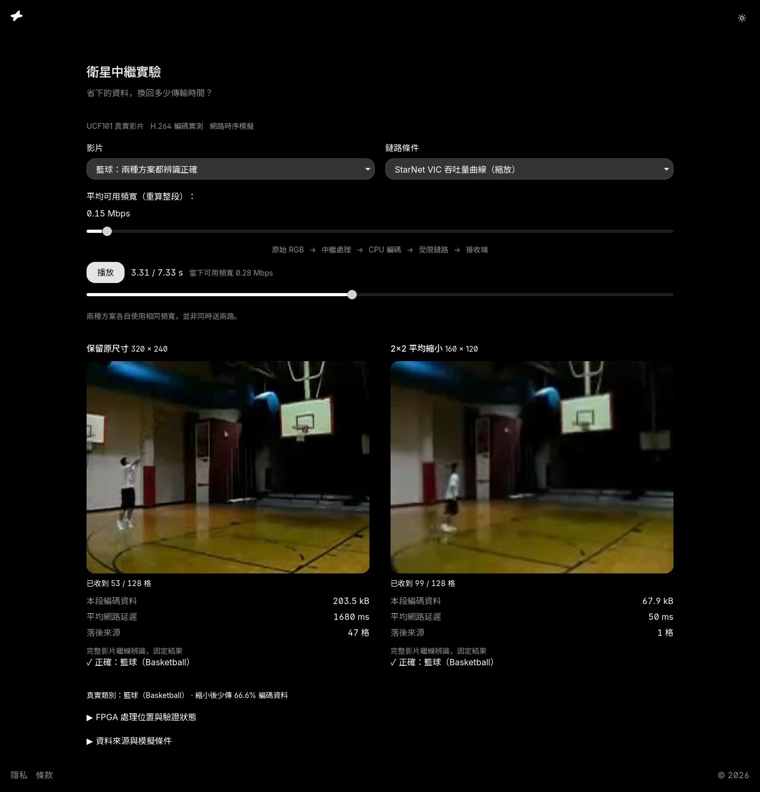

<!-- 翻譯自 README.md @ docs/readme-template-v2。只翻 "For AI agents" 以上的章節，英文版更新時一起改。 -->

<div align="center">

<h1>Task Web</h1>

<p><strong>在 Codex 與 Claude Code 裡，給小型網頁任務一個熟悉的家。</strong></p>

[](https://github.com/zyx1121/task-web/actions)
[](https://github.com/zyx1121/task-web/releases)
[](package.json)
[](LICENSE)

[English](README.md) | **繁體中文** | [简体中文](README.zh-CN.md)

</div>



個人工具或研究 demo 應該從任務本身開始，而不是先排版。Task Web 給每個任務固定的四個角落與專注的工作區，套用 ui.zyx.tw 主題。它不含目錄、發票、登入或資料庫。可以看[線上研究範例](https://dev.zyx.tw/semantic-gateway.html)。

## 功能

- **開新任務**：一個指令複製乾淨的 React 與 Vite 起始專案。
- **沿用外殼**：把四角加進既有的 React 或 Next.js 專案。
- **兩個宿主都能用**：Codex 與 Claude Code 找到同一個 skill。
- **檢查成果**：頁面違反主題、字級、四角或文案規則時，`npm run audit` 會失敗。

## 快速開始

```sh
# Claude Code
claude plugin marketplace add zyx1121/marketplace
claude plugin install task-web@zyx1121

# Codex
codex plugin marketplace add zyx1121/marketplace
codex plugin add task-web@zyx1121
```

開新對話，直接說：「用我的 zyx 模板做一個比較兩個實驗的個人網頁工具。」

## 使用方式

- **指名使用**：Claude Code 用 `/task-web:task-web`，Codex 用 `$task-web`。
- **不透過 agent**，需要 Node.js 22.12 以上：

  ```sh
  node skills/task-web/scripts/create.mjs /path/to/new-task --title "My experiment" --lang en
  cd /path/to/new-task
  npm ci
  npm run dev -- --host 127.0.0.1 --port 5173
  ```

  目的地必須是空的或不存在。指令不會覆寫既有內容。任務內容改 `src/App.tsx`，名稱改 `src/task.config.json`。
- **在既有專案裡**：照[整合指南](skills/task-web/references/integration.md)。沿用它的 provider 與外殼，不要在上面重新產生專案。

| 套件 | 負責 |
|------|------|
| Task Web | 選模板、產生原始碼、組出四角外殼 |
| [ui.zyx.tw](https://ui.zyx.tw) | 管理 token 與 Base UI 元件(`@zyx1121/<name>`) |
| [FDE](https://github.com/zyx1121/fde) | 操作已設定好的工作環境：同步與快照 |

## 設定

沒有設定，也沒有密鑰。plugin 安裝時不跑 MCP server、hook 或建置。起始專案在撰寫時複製 registry，[DESIGN-SOURCE.md](skills/task-web/assets/starter/DESIGN-SOURCE.md) 記錄來源版本與更新主題的指令。

## 限制

- 不含主機、帳號或付費服務。`npm run build` 產出靜態檔，部署由你負責。
- 這個 skill 用於個人工具、臨時頁面與研究 demo。客戶自己的設計會保留。

## 其他

給 AI agent 的結構化資訊與開發說明在[英文版](README.md#for-ai-agents)。

## 授權

[MIT](LICENSE)。字型授權附在各自的檔案或套件裡。
